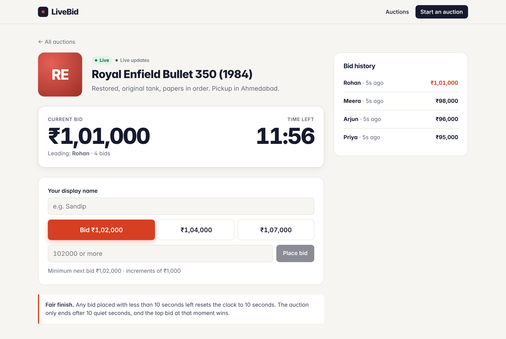
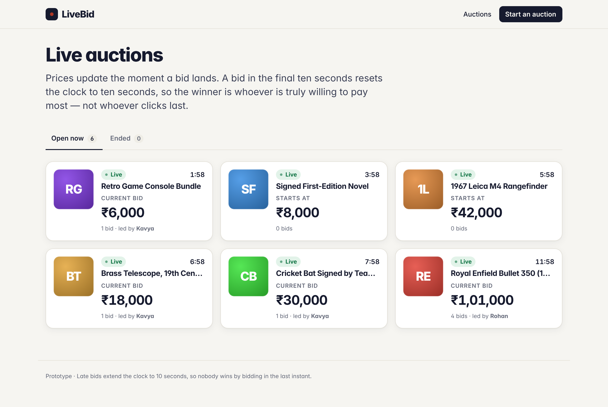
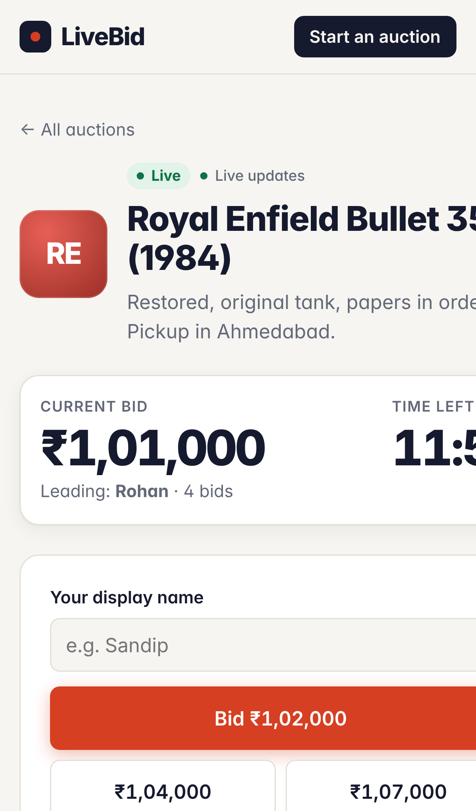
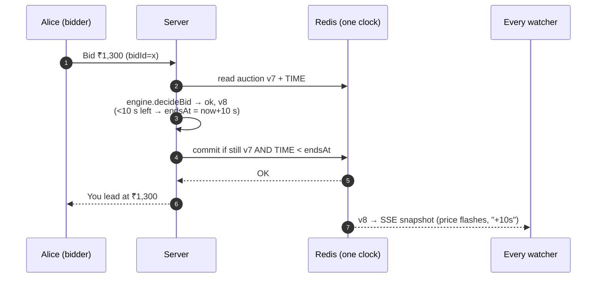
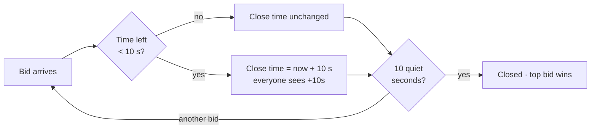

<div align="center">

# 🔴 LiveBid — Live Auction Platform

**Real‑time auctions where every watcher sees the price instantly, late bids extend the clock, and there is never any doubt about who won.**

[**Live demo →**](__LIVE_URL__)


</div>

<p align="center">
  
</p>

<p align="center">
  
  &nbsp;
  
</p>

---

## The brief

> Thousands of auctions run at the same time. A popular one can have hundreds of thousands of people watching, and most of its bids arrive in the final ten seconds. Every watcher must see the current price almost immediately, and when an auction closes there can be no doubt about who won. A late bid extends the auction, so nobody wins by bidding in the last instant.

## How this prototype answers it

| Requirement | Answer | Where |
|---|---|---|
| See the price almost immediately | Server‑Sent Events push a new snapshot the moment a bid is accepted | [`stream/route.ts`](app/api/auctions/[id]/stream/route.ts) |
| No doubt about who won | Atomic compare‑and‑set on a version number; **one clock** (Redis `TIME`) decides the close; "closed" is derived from time, never a flag | [`engine.ts`](lib/engine.ts) · [`redis.ts`](lib/store/redis.ts) |
| Late bids extend the auction | Any bid with < 10 s left resets the clock to 10 s | [`decideBid`](lib/engine.ts) |
| Bids in the final seconds | Idempotent `bidId` so a panicked double‑tap or retry never counts twice | [D7](docs/DECISIONS.md) |
| Same countdown on every device | Clients run on server time (offset from `serverNow`) | [`client.ts`](lib/client.ts) |

## How a bid flows



Two bids racing for the same step? Only one commit sees `v7`; the other re‑reads `v8` and is told the new minimum. A bid that reaches Redis even 1 ms after `endsAt` is rejected — so the leader at close is the winner, by construction.

## The fair finish (anti‑sniping)



## Features (v0.1)

- **Lobby** — every open auction with live price and a server‑synced countdown; *Open now* / *Ended* tabs.
- **Auction room** — huge price and clock, one‑tap bid buttons (minimum, +2×, +5× increment) or a custom amount, live bid history, "You've been outbid" alert, extension notice, winner banner.
- **Start an auction** — title, description, starting price, increment, duration; live the moment it's created.
- **No sign‑up** — pick a display name and bid (auth comes later, see [Tasks](docs/TASKS.md)).
- Mobile‑first, dark mode, reduced‑motion aware.

## Run locally

```bash
git clone https://github.com/Sandipxg/Live-Auction-platform.git
cd Live-Auction-platform
npm install
npm run dev          # http://localhost:3000 — uses the in-memory store, no setup
npm test             # 14 tests: rules, concurrency, idempotency
```

Open the same auction in two browser windows and bid against yourself.

### Use Redis (required for multi‑instance hosting)

Copy `.env.example` to `.env.local` and fill in an [Upstash](https://upstash.com) REST URL and token. On Vercel, add **Upstash for Redis** from the Marketplace — it sets the variables for you (`KV_REST_API_URL` / `KV_REST_API_TOKEN` are also recognised).

## Documentation

| Doc | What's inside |
|---|---|
| [Aim](docs/AIM.md) | The brief and a testable definition of done |
| [Tasks](docs/TASKS.md) | Live progress tracker and roadmap |
| [Context](docs/CONTEXT.md) | Measured colours, type, spacing and motion |
| [Architecture](docs/ARCHITECTURE.md) | Stack, diagrams, folder layout, API, scaling path |
| [Decisions](docs/DECISIONS.md) | Major decisions and their trade‑offs |

## Project structure

```
app/          pages + API routes (Next.js App Router)
components/   Lobby, AuctionRoom, Tile, StatusPill
lib/engine.ts the auction rules — pure, tested
lib/store/    memory + Redis stores behind one interface
tests/        Vitest
docs/         Aim · Tasks · Context · Architecture · Decisions
```

## Roadmap

Milestone 2 — watcher counts, outbid sound, simulated bidders, images · Milestone 3 — auth, reserve price, proxy bidding · Milestone 4 — WebSocket fan‑out and load testing at 300k watchers. Details in [docs/TASKS.md](docs/TASKS.md).

---

<div align="center">Built by <a href="https://sandip.codes">Sandip Godhani</a></div>
