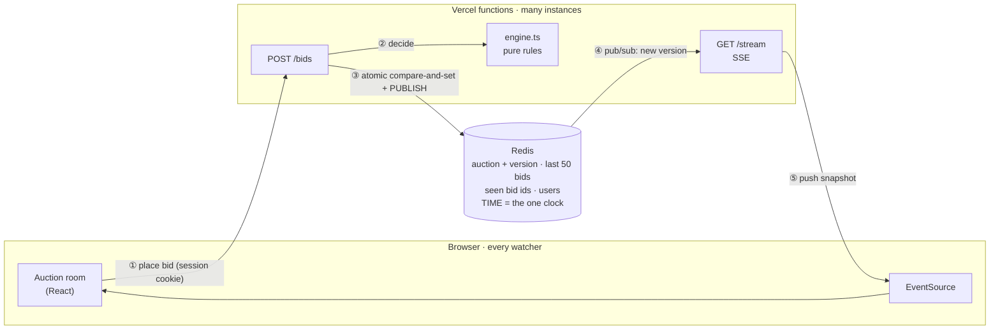
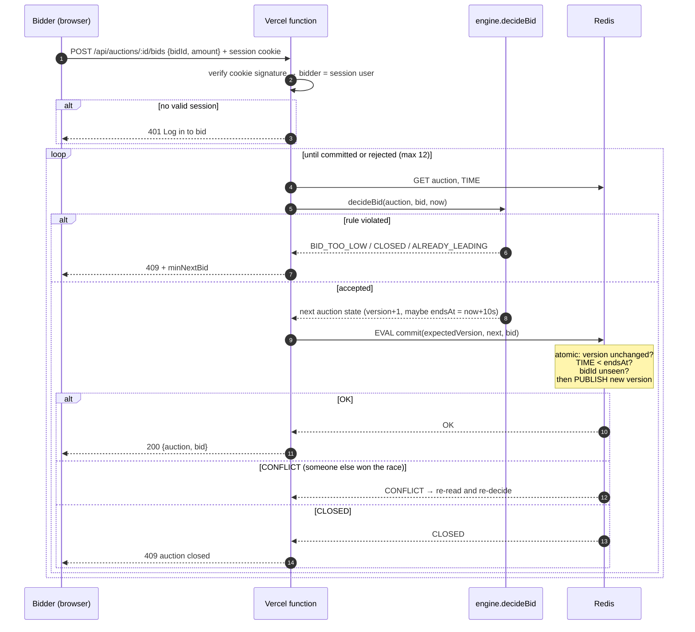
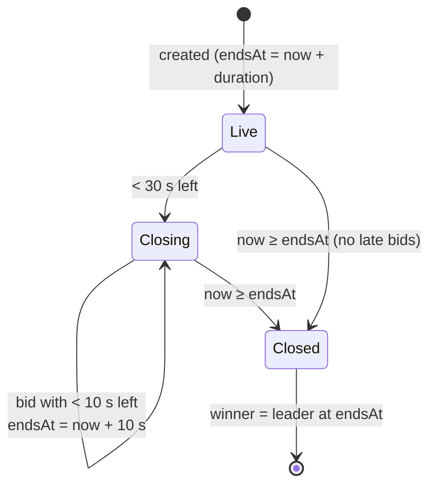
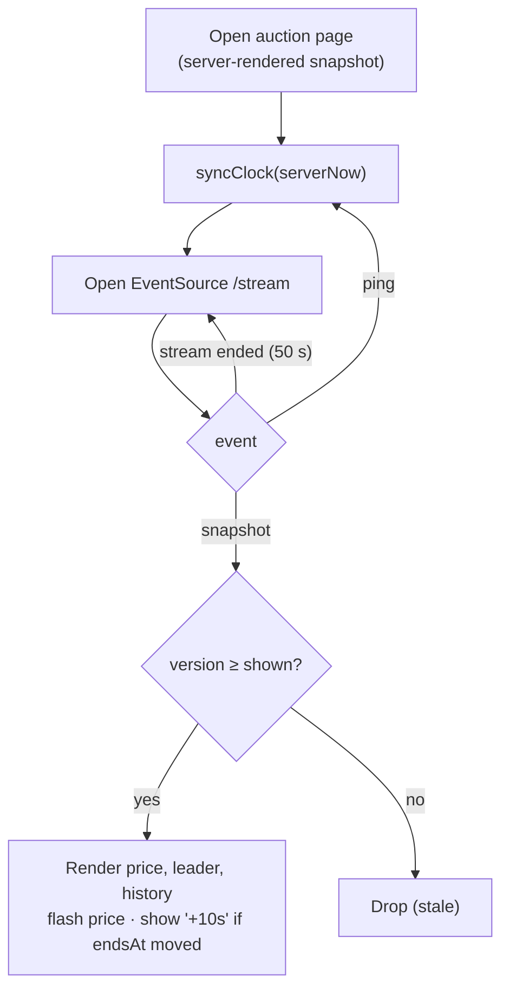
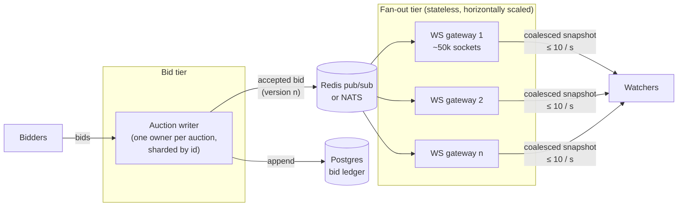

# Architecture

## Stack

| Layer | Choice | Why |
|---|---|---|
| Framework | **Next.js 15** (App Router) + **React 19** + **TypeScript** (strict) | One codebase for UI and API; first‑class on Vercel |
| Live updates | **Server‑Sent Events** (`EventSource`) | One‑way server→browser push over plain HTTP; auto‑reconnect built in; works on serverless |
| State (production) | **Redis** (Redis Cloud via Vercel Marketplace) with **ioredis** | Atomic Lua scripts, a single authoritative clock (`TIME`), pub/sub to push bids across instances |
| Auth | Username/password, **scrypt** hashes, **HMAC‑signed httpOnly cookie** | Stateless sessions; no extra service ([D12](DECISIONS.md)) |
| State (local) | In‑memory store | Zero setup: `npm run dev` just works |
| Styling | Plain CSS with design tokens | No build plugins; every value documented in [CONTEXT.md](CONTEXT.md) |
| Tests | **Vitest** | Fast, TypeScript‑native |
| Hosting | **Vercel** | |

## System overview



Without `REDIS_URL` the same code uses the in‑memory store and pushes updates through an in‑process event emitter.

## Placing a bid



## Auction lifecycle



Status is **derived from time** (`statusOf(auction, now)`), never stored. There is no "close job" that could run late or disagree with the bid path.

## What a watcher sees



The countdown runs on **server time** (`Date.now() + offset`), so every device shows the same seconds remaining.

## Folder layout

```
.
├── app/                         Next.js App Router
│   ├── page.tsx                 Lobby (open / ended auctions)
│   ├── auctions/[id]/page.tsx   Auction room (server-rendered first snapshot)
│   ├── new/page.tsx             Create an auction (login required)
│   ├── login/page.tsx           Log in · sign up · demo accounts
│   ├── api/auth/                login · signup · logout
│   ├── api/auctions/
│   │   ├── route.ts             GET list · POST create
│   │   └── [id]/
│   │       ├── route.ts         GET snapshot
│   │       ├── bids/route.ts    POST bid
│   │       └── stream/route.ts  GET live stream (SSE)
│   ├── layout.tsx · globals.css Shell + design tokens
│   └── not-found.tsx
├── components/                  Lobby, AuctionRoom, LoginForm, UserMenu, NewAuctionForm, Tile, StatusPill
├── lib/
│   ├── engine.ts                ★ The rules. Pure functions, no I/O, fully tested
│   ├── auth.ts                  Password hashing, signed sessions, accounts
│   ├── types.ts                 Auction, Bid, results
│   ├── store/
│   │   ├── types.ts             AuctionStore interface
│   │   ├── memory.ts            Local / fallback store
│   │   ├── redis.ts             Production store (Lua compare-and-set + pub/sub)
│   │   └── index.ts             Picks Redis if configured
│   ├── demo.ts                  Keeps demo inventory topped up
│   ├── client.ts                Browser: server clock
│   └── format.ts                ₹ and countdown formatting
├── tests/                       Vitest: rules, concurrency, idempotency, Redis store, auth
└── docs/                        Aim · Tasks · Context · Architecture · Decisions · Scaling
```

## API

🔒 = requires the session cookie.

| Method | Path | Body | Returns |
|---|---|---|---|
| `POST` | `/api/auth/signup` | `{ username, password, displayName? }` | `201 { user }` + cookie |
| `POST` | `/api/auth/login` | `{ username, password }` | `{ user }` + cookie · `401` |
| `POST` | `/api/auth/logout` | — | clears cookie |
| `GET` | `/api/auctions` | — | `{ auctions, serverNow, store }` |
| `POST` 🔒 | `/api/auctions` | `{ title, description?, startingPrice, minIncrement, durationMinutes }` | `201 { auction }` · `401` |
| `GET` | `/api/auctions/:id` | — | `{ auction, bids, serverNow }` |
| `POST` 🔒 | `/api/auctions/:id/bids` | `{ bidId, amount }` | `200 { ok, auction, bid }` · `409 { reason, minNextBid }` · `401` |
| `GET` | `/api/auctions/:id/stream` | — | `text/event-stream`: `snapshot`, `ping` |

## Scaling path

> Full design with load model, capacity numbers, latency budget and failure modes: **[SCALING.md](SCALING.md)**.

The prototype is correct at any scale; it is not yet *efficient* at the target scale (300k watchers on one auction). The upgrade path keeps the same rules engine and the same guarantees:



1. **Dedicated fan‑out.** Bids are already pushed by pub/sub (one message per accepted bid). Move the watcher connections off serverless functions onto WebSocket gateways that each hold ~50k sockets.
2. **Coalesce.** During the final‑seconds storm, gateways send at most ~10 snapshots/s per auction; each carries the latest version, so nothing is lost.
3. **Single writer per auction.** Route all bids for an auction to one owner (consistent hashing). Bids become a local, in‑order operation — no compare‑and‑set retries under contention.
4. **Durable ledger.** Every accepted bid appended to Postgres for audit and dispute resolution.
