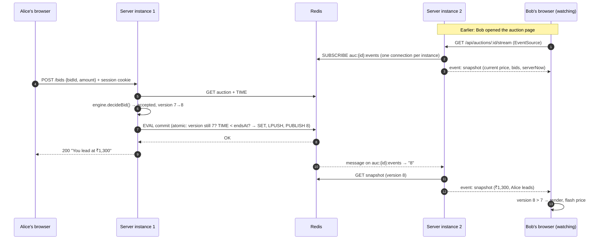
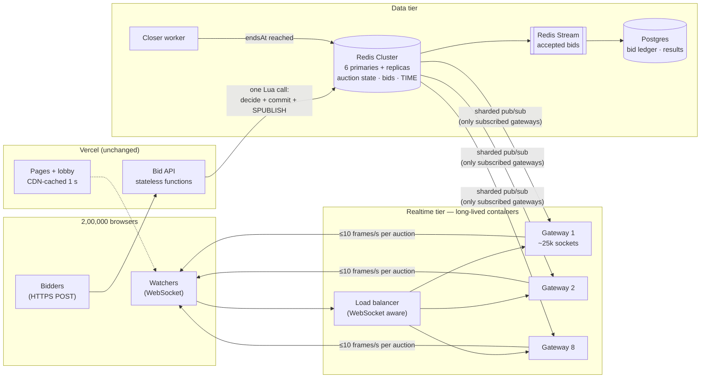
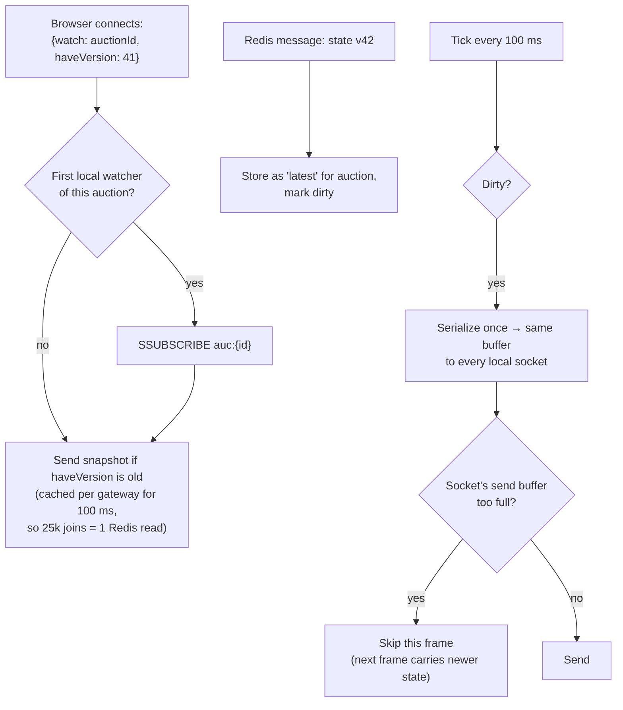
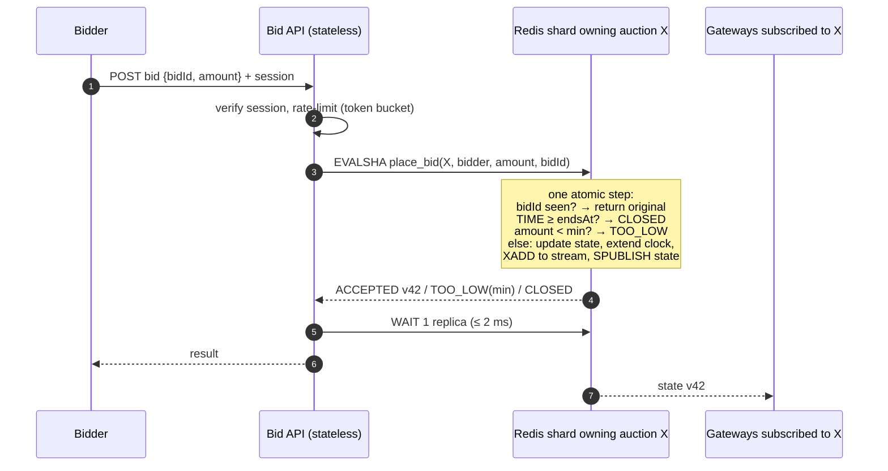

# Scaling

Two parts:

1. **[How live prices work today](#part-1--how-live-prices-work-today)**: what happens between "Alice taps Bid" and "every watcher sees the new price".
2. **[Designing for 50,000 auctions and 2,00,000 watchers](#part-2--designing-for-50000-auctions-and-200000-watchers)**: what has to change, with the numbers worked out.

---

## Part 1 — How live prices work today

### The short version

A bid is decided once, inside Redis, against one clock. The moment it is accepted, Redis **publishes** the new version number. Every server that has watchers for that auction is subscribed, so it immediately pushes the new state down an already‑open **Server‑Sent Events** connection to each browser. Browsers never ask "anything new?"; they are told.

### Step by step



| Piece | What it does | Where |
|---|---|---|
| **EventSource (browser)** | Opens one long‑lived HTTP response and receives `snapshot` events. Reconnects automatically if the connection drops. | `components/AuctionRoom.tsx` |
| **SSE route** | Sends the current snapshot immediately, then pushes a new one whenever the auction changes. Closes after 50 s so a serverless function never hits its time limit; the browser reconnects within 1 s (`retry: 1000`). | `app/api/auctions/[id]/stream/route.ts` |
| **Commit script (Lua)** | The only place a bid becomes real. Atomically checks the version and Redis's clock, writes the auction, appends the bid, and **PUBLISHes** the new version, all in one step. | `lib/store/redis.ts` (`COMMIT_BID`) |
| **Shared subscriber** | Each server instance holds **one** Redis subscriber connection, shared by all its watchers. A message for auction X wakes only the streams watching X. | `RedisStore.subscribe()` |
| **Version numbers** | Every accepted bid increments `version`. Browsers drop any update older than what they show, so the price can never go backwards even if messages arrive out of order. | `AuctionRoom` → `accept()` |
| **Server clock sync** | Every message carries `serverNow`; the browser runs its countdown on server time, so every device shows the same seconds left. | `lib/client.ts` |
| **Safety net** | Every 2 s each stream also checks the version, catching anything a dropped pub/sub message might have missed. A 15 s heartbeat keeps proxies from closing the idle connection. | stream route |

**Measured:** in a local test with two separate server instances on one Redis, a bid accepted on instance 1 reached a watcher on instance 2 in **69–77 ms**.

### Why this is enough for a prototype but not for 2,00,000 watchers

| Today's choice | Cost at 2,00,000 watchers |
|---|---|
| Each watcher holds open one **serverless function** | 2,00,000 concurrent function invocations, far beyond sensible concurrency limits and billed per second of duration |
| Streams end every 50 s and reconnect | ≈ 4,000 reconnects/s, each re‑reading a snapshot from Redis |
| 2 s safety poll per stream | ≈ 1,00,000 Redis reads/s doing nothing useful |
| On each bid, every stream re‑reads the snapshot | A hot auction with 1,00,000 watchers turns **one** bid into **1,00,000** Redis reads |
| Optimistic retry on version conflict | Thousands of simultaneous bids on one auction mostly retry and lose |

The **rules** (`engine.ts`) and the **guarantees** (one clock, atomic commit, idempotent bids, versioned snapshots) stay. What changes is *where connections live* and *how one update reaches many people*.

---

## Part 2 — Designing for 50,000 auctions and 2,00,000 watchers

### Load model

The design is sized against explicit assumptions. Change these and the numbers below scale linearly.

| Quantity | Assumption | Value |
|---|---|---|
| Live auctions at once | given | **50,000** |
| Watchers at once | given | **2,00,000** |
| Hottest auction | half of everyone watches one item (a "hundreds of thousands" moment) | **1,00,000 watchers** |
| Typical auction | the other 1,00,000 spread across 49,999 auctions | **~2 watchers** |
| Average auction | 10 minutes, ~30 accepted bids | **≈ 2,500 accepted bids/s overall** |
| Auctions in their final 10 s at any moment | 10 s / 600 s of 50,000 | **≈ 830** |
| Bid *attempts* on the hottest auction, final seconds | most are "too low" by the time they land | **5,000/s** |
| Peak bid attempts, whole platform | final‑second storms + background | **20,000/s** |
| Accepted bids on the hottest auction | limited by the minimum increment | **≤ 50/s** |

### Targets

| Goal | Target |
|---|---|
| Bid accepted → visible on every watcher's screen | **p99 < 250 ms** |
| Exactly one winner, decided by one clock | **always** (correctness, not a percentile) |
| Watchers converge on the final price after close | **< 1 s** |
| Lose one server of any tier | **no lost bids, watchers reconnect in < 5 s** |

### The core problem: fan‑out

One accepted bid must reach everyone watching that auction. For the hottest auction:

```
naive:      50 accepted bids/s × 1,00,000 watchers = 50,00,000 messages/s
coalesced:  10 frames/s        × 1,00,000 watchers = 10,00,000 frames/s
```

**Coalescing** is the key idea. Watchers need the *latest* price, not every intermediate one. Each gateway sends at most one frame per auction every 100 ms, carrying the newest version. The price is never stale by more than 100 ms, and 50 bids in a burst cost one frame instead of 50. Because every frame is a full state with a version number, skipping intermediate frames loses nothing.

At ~120 bytes per frame (compressed), 10,00,000 frames/s is about **120 MB/s ≈ 1 Gbps** of egress. That is spread over many gateways, so it is comfortable. The other 1,00,000 watchers across 49,999 quiet auctions add only ~5,000 frames/s.

### Target architecture



Six changes from today, each explained below:

1. **Dedicated WebSocket gateways** replace per‑watcher serverless streams.
2. **Coalesced, serialize‑once fan‑out** inside each gateway.
3. **Decide inside Redis** (one Lua call, no retries).
4. **Redis Cluster, sharded by auction**, with **sharded pub/sub**.
5. **Durable bid ledger** and a **closer** for side effects.
6. **CDN‑cached lobby**.

### 1. WebSocket gateways

Small, stateless Node services (e.g. `uWebSockets.js`) on long‑lived containers (Fly.io, AWS ECS, Railway, Kubernetes). Vercel functions are not built to hold 2,00,000 open sockets, so this is the one new kind of infrastructure.

| | Value |
|---|---|
| Sockets per gateway (comfortable) | 25,000–50,000 |
| Gateways | **8** (25,000 each; any one can fail and the other 7 absorb ~29,000 each) |
| Memory per socket (with buffers) | ~40–60 KB → ~1.5 GB per gateway |
| Auth | Verify the existing signed session cookie locally (HMAC), with no database lookup |

What a gateway does:



- **The published message carries the state itself** (`{v, price, leader, endsAt, bidCount, lastBid}`), so a gateway never reads Redis per bid. One bid = one Redis publish per subscribed gateway, regardless of watcher count.
- **Serialize once**: the frame is encoded once and the same bytes are written to all 1,00,000 sockets.
- **Slow phones don't slow anyone else.** A socket that can't keep up just receives the next, newer frame. After 30 s behind, it is disconnected and reconnects fresh.
- **Reconnect storms** (a gateway restarts and 25,000 browsers reconnect): clients back off with random jitter (0–5 s), and the 100 ms snapshot cache means a whole crowd costs one Redis read.

### 2. The bid path: decide inside Redis

Today the server reads, decides in TypeScript, then commits only if nothing changed (optimistic concurrency). With 5,000 attempts/s on one auction, most attempts conflict and retry.

At scale, the **whole rule check moves into the Lua script**: one round trip, no conflicts, no retries. Redis runs scripts one at a time per shard, so they are serialized by design.



- **Capacity:** a Lua call like this takes ~20–50 µs, so one shard handles **20,000–50,000 bids/s**, which is 4–10× the 5,000/s hottest‑auction target.
- **The rules stay in one place logically:** `engine.ts` remains the specification. A shared table of test cases (the existing `decideBid` tests) runs against **both** the TypeScript engine and the Lua script, so they cannot drift.
- **`WAIT 1`** makes the API reply "accepted" only after a replica has the bid. A Redis primary failing a millisecond later cannot erase a bid someone was told they won.
- **Per‑user rate limit** (e.g. 10 bids/s) in Redis stops one script from flooding a hot auction.

### 3. Redis Cluster, sharded by auction

| | Value |
|---|---|
| Key design | Every key of an auction shares a hash tag, e.g. `auc:{8f3a…}` and `auc:{8f3a…}:bids`, so **one auction always lives on exactly one shard** |
| Consequence | **One clock per auction** (that shard's `TIME`), which is all "no doubt who won" requires |
| Shards | **6 primaries + 6 replicas**. 20,000 bids/s peak ≈ 3,300/s per shard; 50,000 auctions ≈ 8,300 per shard (~50 MB of state each) |
| Pub/sub | **Sharded pub/sub** (`SPUBLISH`/`SSUBSCRIBE`, Redis 7+). The message goes only to the shard owning the auction and the gateways subscribed to it. Classic `PUBLISH` would broadcast every message to every node of the cluster. |
| Hot shard | The hottest auction uses ~5,000 of a shard's ~20,000+ ops/s budget. If one item ever exceeds a single shard, the next step is a dedicated **single‑writer process per hot auction** that holds the state in memory and appends to Redis (see "Beyond this" below). |

### 4. Durability and closing

- **Ledger.** The Lua script `XADD`s every accepted bid to a Redis Stream in the same atomic step. A consumer writes them to **Postgres**, an append‑only, auditable record of every accepted bid. This settles any later dispute.
- **Closer.** A sorted set `closing` holds `endsAt` for every live auction. A small worker checks it every 100 ms. When an auction's time is up, it records the result **idempotently** (`SET result:{id} NX`) and triggers notifications and payment. It **never decides** the winner: as today, the winner is whoever led when the shard's clock passed `endsAt`, and no bid can land after that. The closer only reacts.
- **Gateways announce the close** with a final frame (`status: closed, winner`), so all watchers converge within one tick.

### 5. The lobby

50,000 auctions and 2,00,000 people browsing must not mean 2,00,000 database queries.

- **Paginated, pre‑sorted lists** in Redis: `lobby:ending-soon` (by `endsAt`), `lobby:hot` (by watcher count), `lobby:new`.
- **CDN caching:** `Cache-Control: s-maxage=1, stale-while-revalidate=5`. If everyone refreshes every 2 s (≈ 1,00,000 req/s), the origin still serves only about **one request per page per second**.
- The lobby is allowed to be ~1–2 s behind. The **auction room** is the real‑time view.
- **Watcher counts:** each gateway writes `HSET watchers:{id} <gateway> <count>` every 5 s; the lobby sums them.

### Capacity summary

| Tier | Load at peak | Provisioned | Headroom |
|---|---|---|---|
| WebSocket gateways | 2,00,000 sockets; ~10,05,000 frames/s out | 8 gateways × 25k sockets | survives losing 1 gateway |
| Bid API (Vercel) | 20,000 req/s | autoscaling functions | stateless |
| Redis Cluster | 20,000 Lua calls/s + 2,500 SPUBLISH/s | 6 shards × ~20–50k ops/s | 6–15× |
| Hottest auction's shard | 5,000 Lua calls/s | 1 shard | 4–10× |
| Network egress | ~1 Gbps (hot auction) | ~125 Mbps per gateway | ample |
| Postgres ledger | 2,500 inserts/s average, batched | 1 primary + replica | batched writes |

### Latency budget (bid → every screen, p99)

| Step | Time |
|---|---|
| Bidder → Bid API (same region) | ~40 ms |
| Session check + rate limit | ~1 ms |
| Lua decide + commit + `WAIT 1` | ~3 ms |
| `SPUBLISH` → gateway | ~2 ms |
| Coalescing wait (worst case one tick) | ≤ 100 ms |
| Gateway → watcher (mobile network) | ~50–90 ms |
| **Total** | **≈ 200–240 ms** ✅ |

To go lower, shorten the tick to 50 ms (doubles hot‑auction frames to 20,00,000/s) or run gateways in several regions.

### Failure modes

| What fails | What happens | Why no one is wrong about the winner |
|---|---|---|
| A gateway dies | Its ~25,000 watchers reconnect (jittered) to the others within ~5 s and receive a fresh snapshot | Gateways hold no state of record |
| A bid API instance dies mid‑request | The bidder's client retries with the **same `bidId`** | Idempotency: the bid is counted at most once |
| A Redis primary dies | Its replica is promoted in seconds; bids to that shard get "busy, retry" meanwhile | `WAIT 1` means every acknowledged bid is already on the replica |
| Pub/sub message lost | Watchers of that auction are ≤ 1 frame behind; the next bid or a 5 s gateway resync fixes it | Frames are full state with versions |
| A watcher's phone is slow | That phone skips frames; everyone else is unaffected | Per‑socket backpressure |
| Closer is late | Notifications are late | The close already happened, by time, inside Redis |

### How we prove it: load test

Before claiming these numbers, reproduce them (k6 or Artillery with WebSocket support):

1. **Soak:** ramp to 2,00,000 sockets over 10 minutes across 50,000 auctions. Check gateway memory, CPU and frame delay.
2. **Hot item:** 1,00,000 sockets on one auction; in its final 10 s, 5,000 bid attempts/s from 10,000 bidders.
3. **Chaos:** kill one gateway and one Redis primary during the storm.
4. **Assert:**
   - exactly one winner, equal to the highest accepted bid in the Postgres ledger;
   - no accepted bid has a timestamp ≥ the final `endsAt`;
   - every socket's last frame shows the final version within 1 s of close;
   - p99 bid‑to‑screen < 250 ms.

### Roll‑out plan

| Stage | Change | Unlocks |
|---|---|---|
| **0 — today (v0.2)** | SSE on Vercel, Redis pub/sub, optimistic commit | correct at any scale; efficient to ~a few thousand watchers |
| **1** | WebSocket gateway service with coalescing, serialize‑once, backpressure | 2,00,000 watchers |
| **2** | Decide‑in‑Lua with shared test vectors; `WAIT 1`; per‑user rate limit | 5,000 bids/s on one auction, no retries |
| **3** | Redis Cluster with `{id}` hash tags + sharded pub/sub | 50,000 auctions, 20,000 bids/s |
| **4** | Redis Stream → Postgres ledger; closer worker; CDN‑cached lobby | auditability, notifications, cheap browsing |
| **5** | Load test above, then tune tick, shard count and gateway count | confidence in the numbers |

### Beyond this

- **One item with millions of watchers:** add a second fan‑out layer (gateways subscribe to regional relays instead of Redis), or use a managed realtime service (Ably, Pusher, Cloudflare Durable Objects). Managed services trade operations work for per‑message cost; at ~10 lakh frames/s that cost is significant, so self‑hosted gateways are the default here.
- **One item with more bids than a Redis shard can take:** a single‑writer process per hot auction (actor model) keeps the state in memory and appends to a log. It is the same "one decision point, one clock" principle, just faster.
- **Multiple regions:** gateways in every region for low latency. Bids for an auction still go to the one region that owns it, because one clock must decide.
